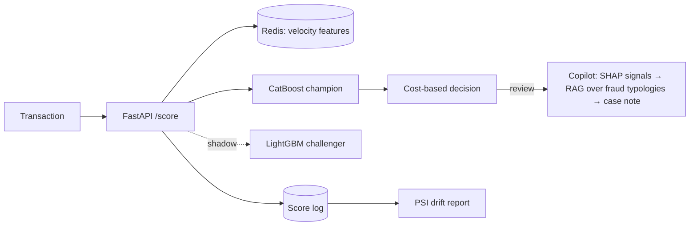

# Real-time Fraud Decisioning + LLM Analyst Copilot

Scores a card transaction in real time, decides **approve / review / decline** from the cost of errors, and drafts a case note for the fraud analyst that names the likely fraud pattern with cited sources.

> **Status: in progress.** Built in public: milestones below are ticked as they land, and the Results section is filled with real numbers only.

## Why
Fraud teams don't optimise F1. They balance **money lost to missed fraud** against **good customers declined**, under a latency budget and a limited manual-review capacity. This project builds that decision loop end to end, from point-in-time features to an explanation an analyst can act on.

## Architecture (planned)


## Data
[IEEE-CIS Fraud Detection](https://www.kaggle.com/c/ieee-fraud-detection) (Kaggle): ~590k card-not-present transactions, ~3.5% fraud. The data is not redistributed here; `scripts/download_data.sh` fetches it via the Kaggle API after you accept the competition rules.

## Approach
- **Time-based split:** train on days 0–120, validate on 121–150, test on 151–182. No random split.
- **Velocity features from the past only:** count / sum per card and device over 1 h · 24 h · 7 d, amount vs the card's usual amount, new device, cards per device. The same definitions run offline and online, and a parity test checks they match.
- **Model:** CatBoost with calibrated probabilities, compared against a rules baseline and logistic regression.
- **Decision:** thresholds minimise expected cost from `configs/costs.yaml` (missed fraud vs declined good customer vs manual review), with a review-capacity limit.
- **Serving:** FastAPI `/score` backed by Redis, a p95 latency target under 50 ms, Docker Compose.
- **Safe model updates:** a challenger model runs in shadow mode; PSI monitors feature and score drift.
- **Analyst copilot:** for `review` cases, SHAP drivers are mapped to plain-language signals (e.g. *6 transactions in 1 h*, *new device*). Hybrid retrieval (BM25 + embeddings + re-ranker) over fraud-typology notes and public fraud and chargeback documents finds the matching pattern (card testing, account takeover, BIN attack…). A structured case note follows, with citations checked in code. If nothing matches, the copilot says `no_match` instead of guessing.

## Milestones
- [ ] Data download, EDA, time-based split
- [ ] Velocity features + no-future-leak test
- [ ] Baselines (rules, logistic regression) and CatBoost tracked in MLflow
- [ ] Calibration and cost-based thresholds
- [ ] Redis online features + offline/online parity test
- [ ] FastAPI `/score`, Docker Compose, load test (p50 / p95 / p99)
- [ ] Shadow-mode challenger and PSI drift report
- [ ] pytest + GitHub Actions CI
- [ ] Copilot: signal dictionary, fraud-typology knowledge base, hybrid retrieval, cited case notes
- [ ] Copilot evaluation on 50 hand-labelled cases
- [ ] Demo app and GIF

## Results
| Model | PR-AUC | Recall @ 1% decline | Loss per 100k transactions | p95 latency |
|---|---|---|---|---|
| Rules baseline | – | – | – | – |
| CatBoost | – | – | – | – |

Copilot (50 labelled cases): typology accuracy –, faithfulness –, retrieval recall@5 –.

_Filled in as milestones land._

## Repository layout (planned)
```
configs/      features.yaml · costs.yaml · signals.yaml
src/fraud/    data · features (offline / online) · train · decision · api · monitoring · copilot
kb/           fraud-typology notes and public source documents
eval/         model and copilot evaluation scripts
tests/        no-future-leak · parity · decision · api · copilot
```

## Limitations (known up front)
- Kaggle data from 2019 with anonymised features; the card id is a heuristic.
- Error costs are stated assumptions, not a bank's real figures.
- Traffic is replayed from the dataset, not live; label delay (chargebacks arrive weeks later) is not simulated.

## License
Code: MIT. Data: subject to the Kaggle competition rules.
